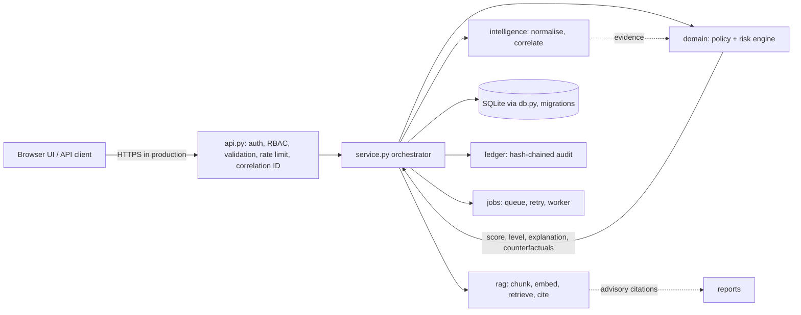

# Architecture

Rules from the brief, and how they are enforced:

* **Domain independence**: `domain/` imports only the standard library. **LLM/AI never scores**: intelligence and RAG only produce `EvidenceItem`s or advisory citations; `assess()` is the sole scoring function (tests: `test_retrieval_never_changes_the_score`).
* **Determinism**: `assess(items, as_of, policy)` is pure (Decimal arithmetic, sorted inputs, no clock). `as_of` is stored with each run, which is what makes replay possible.
* **Policy versioning**: `RiskPolicy` is content-hashed; runs store `policy_version` and `policy_hash`. Weights/bands change only by adding a new policy version (existing runs stay replayable under theirs).

## Scoring (policy v1.0)

1. Each evidence item has `severity` (none…critical → 0, 10, 25, 50, 75, 95 points) and `confidence` 0–1. Impact = points × confidence; resolved items have impact 0.
2. Per factor, impacts combine by *noisy-OR* (`100 × (1 − Π(1 − impact/100))`): independent evidence compounds with diminishing returns and stays ≤ 100.
3. Total = Σ(score × weight) / Σ(weights of factors that have evidence). Weights 0.30/0.25/0.20/0.15/0.10 are exactly the brief's. Missing factors are excluded, flagged and reported via `coverage`.
4. Score is rounded half-up to 2 decimals; level uses half-open bands `[0,20) Minimal … [80,100] Critical`.
5. Evidence sources: findings (CVSS can *escalate* declared severity; known-exploited CVEs add threat evidence), correlated intelligence (threat), asset inventory (exposure), all recorded in the run snapshot.

**Documented deviations/assumptions (need owner sign-off):**
* The brief's illustration (80/60/70/40/50 → "63") is arithmetically **64.00** under its own formula; tests assert 64.00. Level (High) is unchanged.
* The brief's integer bands leave gaps (e.g. 19.5); half-open intervals close them without moving any threshold.
* "Accepted" findings still count as risk; only "resolved" removes impact.
* Time does not reduce impact; staleness lowers the reported *trust* and raises a warning.

## Data and persistence
SQLite with numbered migrations (`schema_migrations`), CHECK/FK constraints, indexes on FKs/status/timestamps, `BEGIN IMMEDIATE` transactions (run + ledger entry commit or roll back together; tested). Entities: users, api_keys, vendors, assets, assessments, assessment_runs, findings, evidence, indicators, signals, vuln_records, documents, chunks, workflows, workflow_actions, reports, jobs, audit_events.
*PostgreSQL differences (not tested here)*: replace `AUTOINCREMENT` with `GENERATED … AS IDENTITY`, `INSERT OR IGNORE` with `ON CONFLICT DO NOTHING`, `RAISE(ABORT)` triggers with PL/pgSQL, use a connection pool instead of the single locked connection, and use `timestamptz`.

## Security controls
scrypt password hashing (equalised timing for unknown users) · HS256 tokens with pinned algorithm and expiry, and the user's role/status re-read from the database on every request (disabled users lose access immediately, token claims cannot escalate) · deny-by-default RBAC with three roles · scoped, hashed, revocable API keys · token-bucket rate limits (read/write/login) · strict schema validation (unknown fields rejected) · body-size limit · SSRF guard (private/loopback/link-local/metadata/IPv4-mapped, DNS-answer checking, port allow-list; no outbound fetching is enabled in the baseline) · upload type/size checks · escaped HTML reports served sandboxed with CSP · UI never injects HTML strings · generic 500s with correlation ID · secrets only from the environment (production refuses to start without a strong `SECRET_KEY`).

## Observability and workers
JSON logs with a correlation ID per request (honours a sanitised `X-Request-ID`; jobs inherit the originating ID), `/metrics` (admin) with request/latency/job/auth counters, `span()` timing records (log-based, *not* OpenTelemetry exports), `/health/live` and `/health/ready`. Jobs: `queued → running → succeeded|failed`, attempts counted, bounded exponential backoff (2·2ⁿ s, capped), idempotency keys, permanent failure for validation errors, stuck-job recovery, graceful worker shutdown. `?async=1` on run/collect/documents/reports enqueues.
*Production evolution*: broker-backed queue (Redis/Celery/ARQ), OIDC/JWKS, Argon2id, KMS-held keys, shared rate-limit store, off-box ledger anchoring, OpenTelemetry exporter, semantic embeddings + a real vector store.
